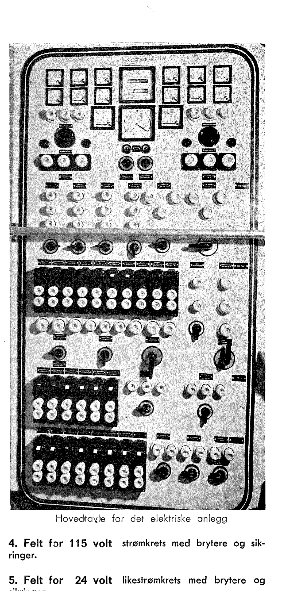
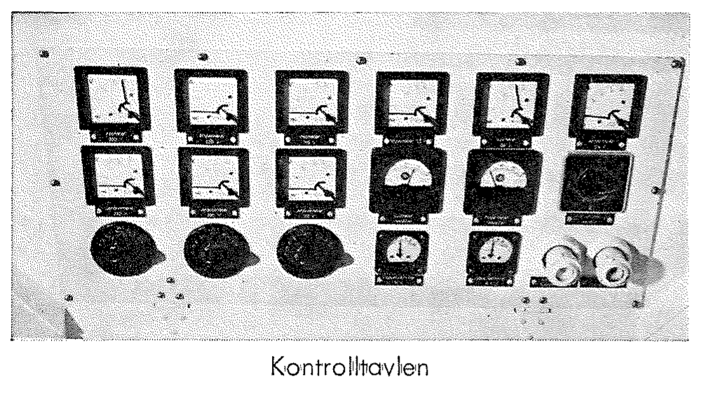
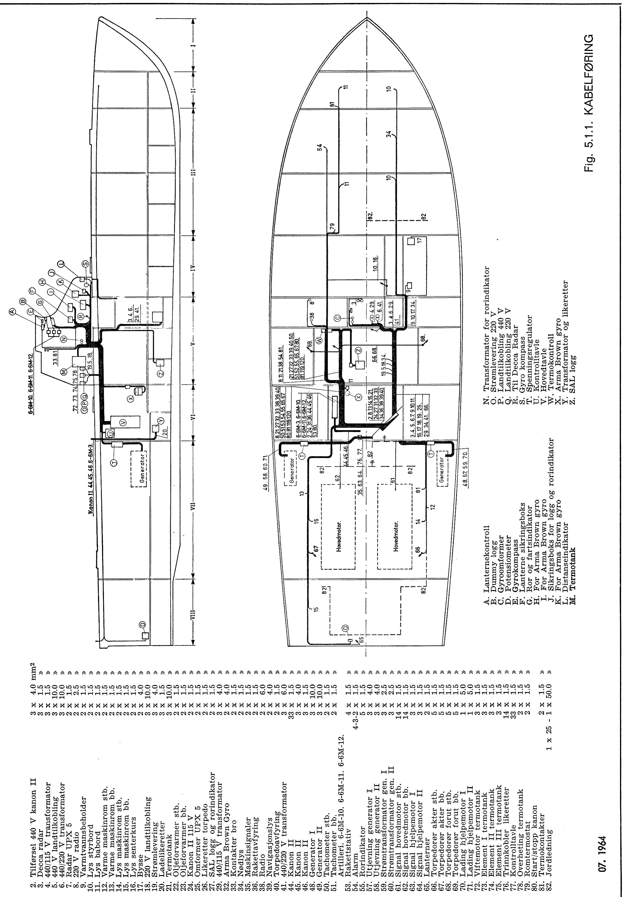
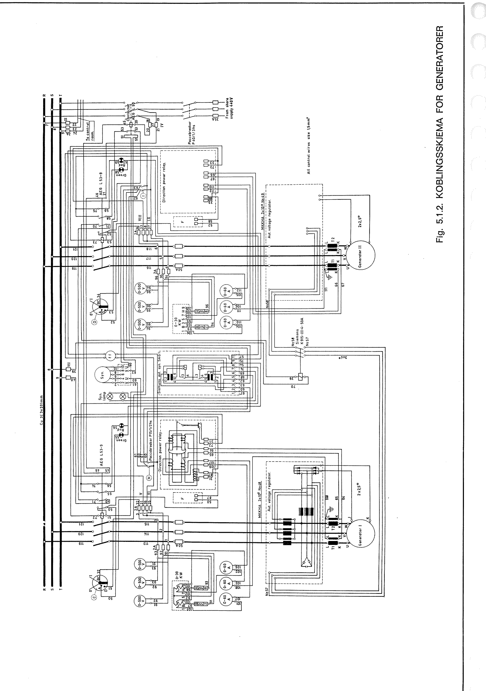
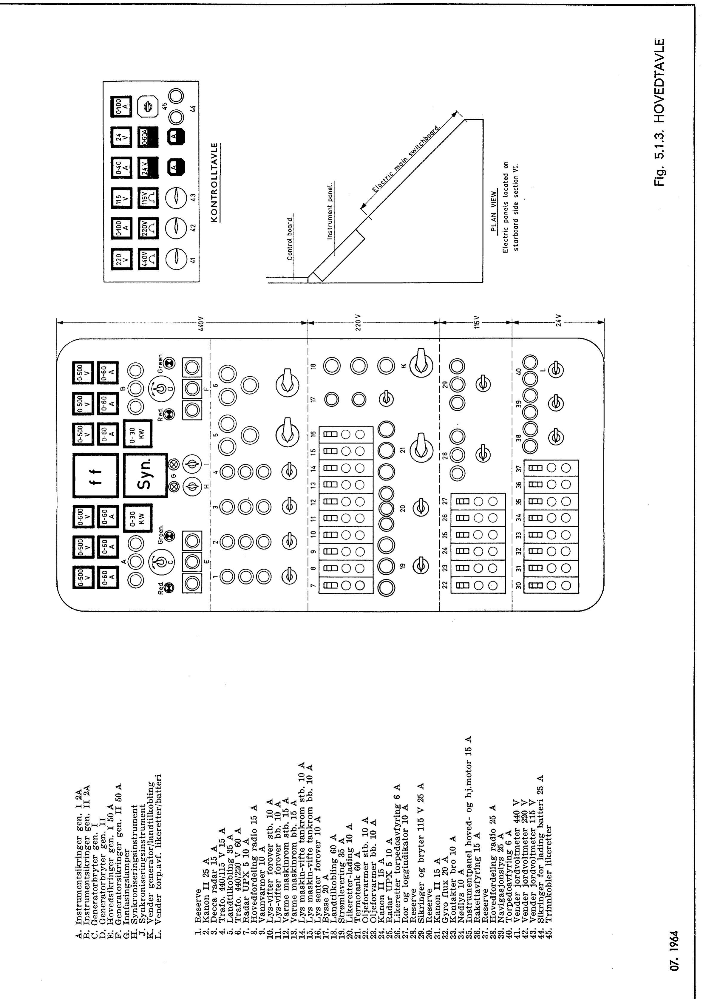
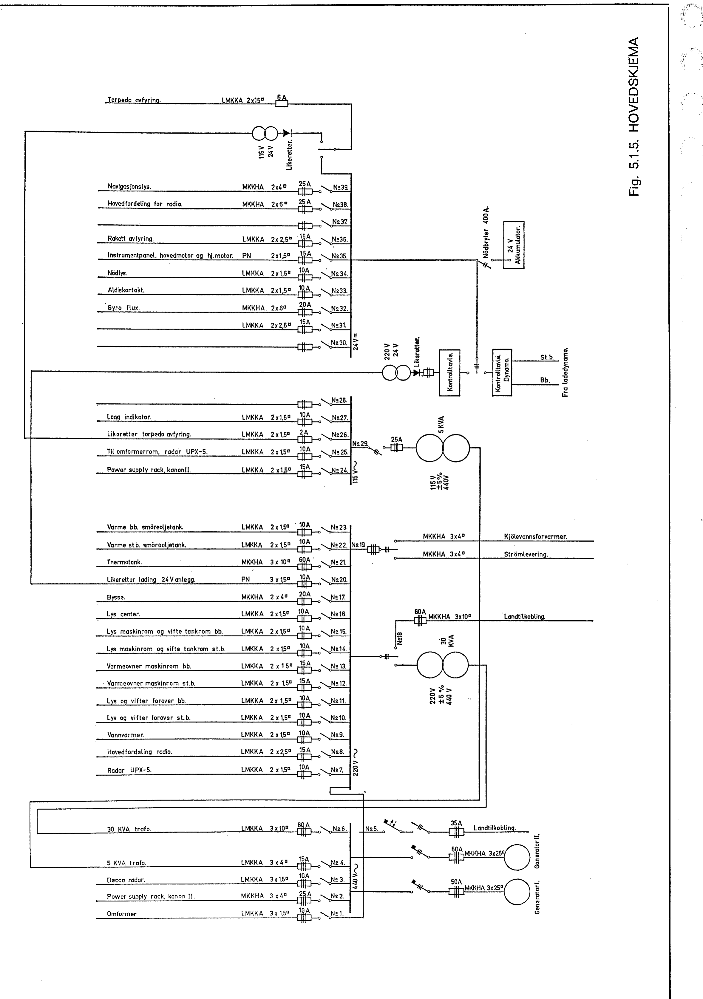
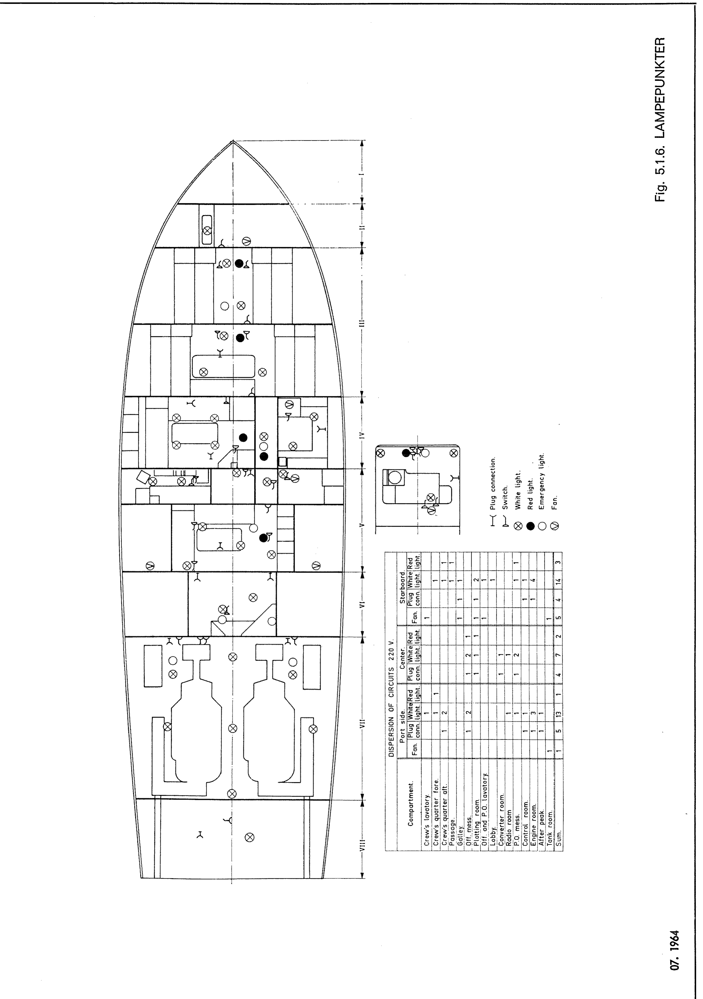
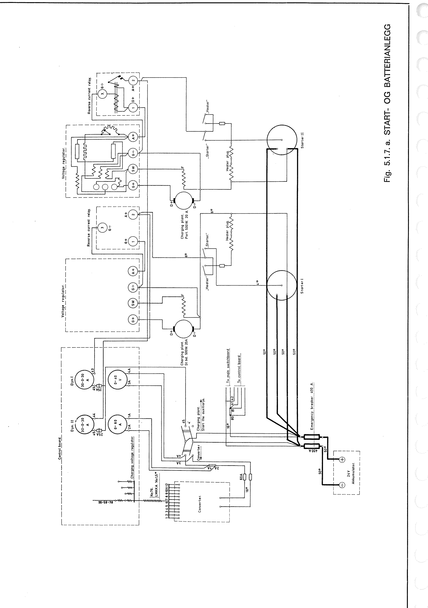
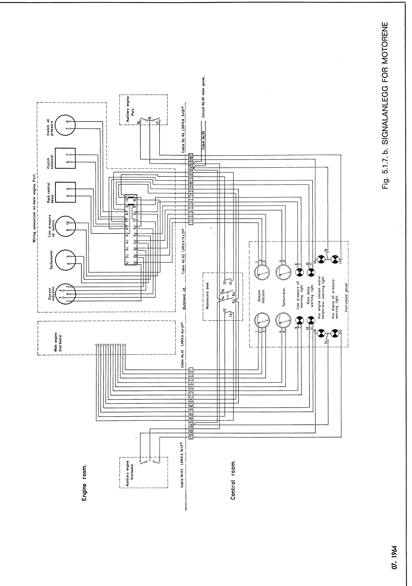
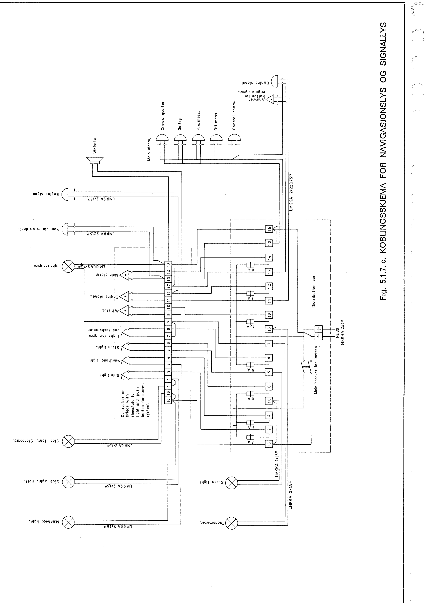

This page translates Chapter 5, *Elektrisk anlegg*, of the Tjeld handbook in the HaandbokTjeld project. It describes the installation as documented in the handbook.

## 5.1 Electrical installation

The [chapter contents on page 105](scans/side-105.jpg) list sections 5.1.1–5.1.7 and the [drawings](#drawings). The [scan of page 106](scans/side-106.jpg) is also available.

### 5.1.1 General description

The electrical installation consists of two generators and a main switchboard with sections for 440 V, 220 V and 115 V AC, and a section for 24 V DC. It also includes a control panel, a 440/220 V transformer, a 440/115 V transformer, a 220 V AC to 24 V DC transformer and rectifier, a 24 V battery, 440 V and 220 V shore power inlets, a 220 V power outlet, and the necessary cables, instruments, fuses and junction boxes.

### 5.1.2 Generators

The auxiliary engines drive the generators (see section 3.2 of the handbook). Each generator is rated at 27.5 kVA, three-phase, 440 V AC at 60 Hz.

The generators supply power through automatic voltage regulators mounted on the bulkhead above them.

As soon as the generators rotate, the voltmeters on the main switchboard indicate the voltage (see [Fig. 5.1.2](#fig-5-1-2)). Close switch H or I to energise the synchronising instruments. Adjust the auxiliary engine speed until the frequency meter marked ff on the main switchboard indicates the required frequency. Then close switch C or D on the main switchboard to energise the 440 V section.

See section 8.5 of the handbook for synchronising the generators for parallel operation and for operating the generators and switchboards.

### 5.1.3 Main switchboard and control panel

The main switchboard ([Fig. 5.1.3](#fig-5-1-3)) is made of aluminium plate and mounted with a rubber strip on the starboard side of the control room.

Power comes from either the generators or the shore connection. The switchboard carries the necessary instruments, switches and fuses, and distributes power to the main circuits through the switches. It has five sections.

1. The upper section contains the instruments, switches, indicator and synchronising lamps, instrument fuses and main fuses for both generators. The starboard generator controls are on the left and the port generator controls are on the right.
2. The 440 V section has switches and fuses for the 440 V shore power connection.
3. The 220 V section has selector switches and fuses for the 220 V AC shore power connection.
4. The 115 V section has switches and fuses.
5. The 24 V DC section has switches and fuses.

*Hovedtavle for det elektriske anlegg*

The following equipment is mounted behind the switchboard.

- Generator directional power relays.
- Contactor for the 440 V AC shore power connection.
- Transformers and contactors for the synchronising and indicator lamps.
- Fuses for the 440 V AC earth voltmeter, the 220 V AC earth voltmeter, the 115 V AC earth voltmeter and voltmeter, and the 24 V DC voltmeter.
- Main contactor and reverse-power relay for generator I.
- Main contactor and reverse-power relay for generator II.
- Synchronising and indicator lamps, synchroscope and frequency meter for generators I and II.
- Contactor for the 440 V AC shore power connection (also listed above in the handbook).

Access to the rear of the switchboard is from the engine room through a watertight hatch on the starboard side.

**Warning: High voltage. Danger of death!**

The control panel ([Fig. 5.1.3](#fig-5-1-3)) is on the centreline at the aft end of the control room, above the control room window. It is made of aluminium plate, hinged at the bottom and secured by screws at the top. It carries various voltmeters, ammeters and ohmmeters, with switches.

*Kontrolltavlen*

The 440/220 V and 440/115 V transformers are in the aft part of the transformer room. They are mounted on foundation blocks secured to the deck.

The 220 V AC to 24 V DC transformer and charging rectifier are below the control room deck on the port side, secured to longitudinal girder A.

The 24 V lead-acid battery is in a separate box below the deck on the centreline of the control room. The box vents to the weather deck through the ladder stringers.

The shore power inlets and the power outlet are in a cabinet on the starboard side at the aft end of the bridge superstructure. They are marked as follows.

1. 440 V AC shore power inlet.
2. 220 V AC shore power inlet.
3. 220 V AC power outlet.

### 5.1.4 Transformers and battery

**440/220 V transformer.** The 440 V section of the main switchboard supplies the 220 V section through a three-phase dry-type transformer. The transformer was supplied by A/S Rich. Pheiffer Elektrisk Verksted og Transformatorfabrikk, Sarpsborg. It is type KT-TS, rated at 30 kVA and 60 Hz, with a 440 V primary and a 220 V secondary.

**440/115 V transformer.** The 440 V section of the main switchboard supplies the 115 V section through a three-phase dry-type transformer from the same manufacturer. It is type KT-TS-5, rated at 5 kVA and 60 Hz, with a 440 V primary and a 115 V secondary.

**220 V AC to 24 V DC transformer and rectifier.** A transformer and rectifier charge the battery. Standard Telefon og Kabelfabrikk, Oslo, supplied both units. The transformer is type K24-60A4T, with a 220 V primary and a 24 V secondary. The rectifier is type K24-60A4T, rated at 60 A.

**24 V lead-acid battery.** Two 12 V lead-acid batteries connected in series supply the 24 V section of the main switchboard. They are Anker type 6 R 10 and have a capacity of 200 Ah.

**Note.** Keep the lead-acid battery as fully charged as possible. Check the electrolyte specific gravity and water level regularly. Top up with distilled water as needed. The acid is corrosive.

### 5.1.5 Outgoing circuits

See [Fig. 5.1.5](#fig-5-1-5) for the 440 V, 220 V and 115 V AC circuits and the 24 V DC circuits.

### 5.1.6 Lighting points

See [Fig. 5.1.6](#fig-5-1-6) for the 220 V AC and 24 V DC lighting points.

### 5.1.7 24 V circuit

The 24 V section is supplied by a battery permanently wired through an emergency switch mounted below the control console.

The 24 V system supplies the auxiliary engine starters (see [Fig. 5.1.7.a](#fig-5-1-7-a)), emergency lighting, navigation lights, alarms and other loads (see [Fig. 5.1.7.c](#fig-5-1-7-c)).

When starting the auxiliary engines, set the selector switch below the control console to position I, marked “Dynamo charging and auxiliary engine starting” (*Lading dynamo og start hjelpemotor*). As soon as one auxiliary engine starts, its dynamo charges the battery. The ammeter on the control panel indicates the charging current.

When the vessel is connected to 220 V shore power, the transformer and charging rectifier can charge the battery. Set the selector switch to position II, marked “Rectifier charging” (*Lading likeretter*).

The 24 V system supplies the navigation lights and alarms ([Fig. 5.1.7.c](#fig-5-1-7-c)). A cabinet on the port side of the plotting room contains the main switch for the navigation lights and the fuses for the individual circuits. The control cabinet on the port side of the bridge contains the lighting rheostats and the alarm push-buttons.

[Original text, page 107](scans/side-107.png) · [Original text, page 108](scans/side-108.png)

The handbook prints 440/120 V in the transformer heading. This translation uses 440/220 V, the primary and secondary voltages specified in section 5.1.4. The starter circuit link follows the drawing caption, which identifies it as Fig. 5.1.7.a. The running text in the handbook cites Fig. 5.1.7.b.

## Drawings

### Fig. 5.1.1. KABELFØRING {#fig-5-1-1}

[Original drawing, page 109](scans/side-109.png)

### Fig. 5.1.2. KOBLINGSSKJEMA FOR GENERATORER {#fig-5-1-2}

[Original drawing, page 110](scans/side-110.png)

### Fig. 5.1.3. HOVEDTAVLE {#fig-5-1-3}

[Original drawing, page 111](scans/side-111.png)

### Fig. 5.1.5. HOVEDSKJEMA {#fig-5-1-5}

[Original drawing, page 112](scans/side-112.png)

### Fig. 5.1.6. LAMPEPUNKTER {#fig-5-1-6}

[Original drawing, page 113](scans/side-113.png)

### Fig. 5.1.7.a. START- OG BATTERIANLEGG {#fig-5-1-7-a}

[Original drawing, page 114](scans/side-114.png)

### Fig. 5.1.7.b. SIGNALANLEGG FOR MOTORENE {#fig-5-1-7-b}

[Original drawing, page 115](scans/side-115.png)

### Fig. 5.1.7.c. KOBLINGSSKJEMA FOR NAVIGASJONSLYS OG SIGNALLYS {#fig-5-1-7-c}

[Original drawing, page 116](scans/side-116.png)
